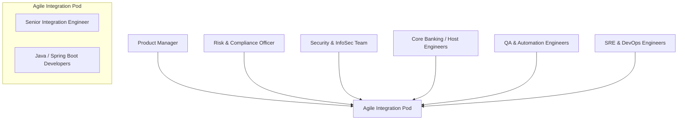

# Engineering Guide: Agile Cross-Functional Collaboration in FinTech

## 1. Cross-Functional Team Composition in Financial Integrations
Building mission-critical financial software requires seamless collaboration between technical, operational, and regulatory stakeholders:



### Key Stakeholder Roles & Interactions:
1. **Product Manager**: Defines business rules (e.g., maximum daily transfer limits, transaction fee schedules).
2. **Core Banking System (CBS) Engineers**: Provide WSDL definitions, test stubs for Temenos T24 / Finacle, and batch clearing schedules.
3. **Risk & Compliance Officers**: Enforce Anti-Money Laundering (AML), Know-Your-Customer (KYC), and National Bank daily limits.
4. **Information Security (InfoSec)**: Mandates TLS 1.3, HSM key rotation, zero-trust token signing, and non-root Docker deployments.
5. **QA & Automation Engineers**: Execute end-to-end integration tests and JMeter load tests.
6. **SRE / DevOps**: Manages Kubernetes clusters, CI/CD pipelines, and 24/7 on-call incident alerts.

---

## 2. Agile Cadences & Ceremonies in Practice

### A. Two-Week Scrum Sprints (Feature Delivery)
Used when developing new payment capabilities (e.g., adding Bank-to-Wallet or QR Merchant Settlement):
- **Sprint Planning**: Decomposes user stories into Jira tasks with acceptance criteria (e.g., *"As a merchant, I want C2B payments to acknowledge within 2 seconds with idempotency guarantees"*).
- **Daily Standup (15 mins)**:
  1. What did I achieve yesterday? (e.g., implemented `AccountController` CRUD endpoints).
  2. What will I do today? (e.g., hook up optimistic locking on balance adjustments).
  3. Any blockers? (e.g., waiting for Core Banking test SOAP endpoint credentials).
- **Sprint Review & Demo**: Live demonstration of Postman C2B payments executing against the test bank ledger.
- **Sprint Retrospective**: Identifies pipeline bottlenecks (e.g., optimizing SonarQube scan speeds).

### B. Kanban Flow (Production Support & Partner Onboarding)
Used for operational maintenance, tier-2 support, and merchant aggregator onboarding:
- Work-In-Progress (WIP) limits prevent engineers from context-switching across too many partner issues.
- Fast-track lane for high-severity production incidents.

---

## 3. Production Incident Management & High-Availability SLAs

### Financial Service Level Agreements (SLAs)
- **Tier-1 Financial Gateway Availability**: **99.99% Uptime** (less than 52 minutes of unplanned downtime per year).
- **Transaction Latency Target**: 95% of transactions processed in **under 1,500 milliseconds**.

### Incident Response Protocol:
1. **Detection**: Prometheus / Alertmanager fires an alert to PagerDuty: *"C2B error rate > 2% over 5 minutes"*.
2. **Triage**: On-call engineer inspects Kubernetes logs:
   ```bash
   kubectl logs -l app=mpesa-fintech-bridge -n fintech --tail=100
   ```
3. **Mitigation**:
   - If downstream CBS is degraded, enable the Circuit Breaker to return graceful messages.
   - If a pod crashed, Kubernetes automatically restarts it; if CPU spikes, HPA scales up replicas.
4. **Blameless Post-Mortem (Root Cause Analysis - RCA)**:
   - Identify the root cause using the **5-Whys methodology**.
   - Create action items in Jira to prevent recurrence (e.g., increase socket timeout on `CoreBankingSoapClient`, add automated JMeter stress tests to CI).
