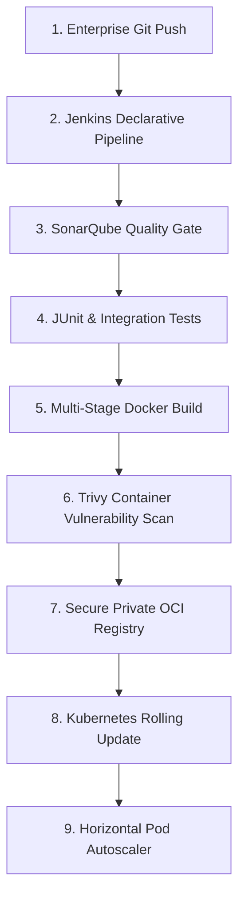

# Engineering Guide: DevOps, CI/CD & Cloud-Native Infrastructure

## 1. DevOps Lifecycle in Financial Institutions
In high-security banking environments, DevOps bridges the gap between software development and production site reliability. It guarantees that every code change is scanned for vulnerabilities, tested for performance, packaged into a hardened container, and deployed with **zero downtime**.



---

## 2. Step-by-Step Implementation in this Project

### Step 1: Version Control & Git Strategy
- **Trunk-Based Development**: Short-lived feature branches (`feature/c2b-reversal`, `fix/idempotency-race-condition`) merged into `main` after passing automated CI checks.
- **`.gitignore` Protection**: Excludes build artifacts (`target/`), compiled `.class` files, IDE configs (`.idea/`, `.vscode/`), and local logs:
  - File: [`.gitignore`](file:///d:/projects/safariintegration/.gitignore)

### Step 2: Multi-Stage Secure Docker Containerization
In financial deployments, container security is paramount. Attackers must not have access to compilers, debuggers, or root user privileges.

In [Dockerfile](file:///d:/projects/safariintegration/Dockerfile):
```dockerfile
# Stage 1: Build JAR using Maven & JDK 21
FROM maven:3.9.9-eclipse-temurin-21-alpine AS builder
WORKDIR /app
COPY pom.xml .
RUN mvn dependency:go-offline -B
COPY src ./src
RUN mvn clean package -DskipTests

# Stage 2: Minimal, secure JRE 21 runtime
FROM eclipse-temurin:21-jre-alpine
WORKDIR /app

# Non-root user for banking security compliance (PCI-DSS)
RUN addgroup -S mpesa && adduser -S mpesa -G mpesa
USER mpesa

COPY --from=builder /app/target/mpesa-fintech-bridge-1.0.0-SNAPSHOT.jar app.jar

EXPOSE 8080
ENTRYPOINT ["java", "-XX:+UseG1GC", "-XX:MaxRAMPercentage=75.0", "-jar", "app.jar"]
```

#### Why These Flags Matter:
- `-XX:+UseG1GC`: Low-pause garbage collector optimized for multithreaded financial workloads.
- `-XX:MaxRAMPercentage=75.0`: Informs JVM to respect cgroup memory limits assigned by Kubernetes, preventing sudden Out-Of-Memory container kills (`OOMKilled`).

---

### Step 3: Kubernetes Container Orchestration
The bridge runs as a distributed cluster workload inside Kubernetes:

1. **ConfigMap ([k8s/configmap.yaml](file:///d:/projects/safariintegration/k8s/configmap.yaml))**:
   Separates environment configuration from application binaries.
2. **Deployment ([k8s/deployment.yaml](file:///d:/projects/safariintegration/k8s/deployment.yaml))**:
   - `replicas: 3`: Ensures high availability across multiple availability zones.
   - `strategy: RollingUpdate (maxSurge: 1, maxUnavailable: 0)`: Ensures zero downtime during new version deployments.
   - `securityContext`: Runs container with non-root UID 1000.
   - `resources`: Allocates minimum `500m CPU / 512Mi RAM`, caps at `1000m CPU / 1024Mi RAM`.
   - `livenessProbe` & `readinessProbe`: Continuously monitors container health.
3. **Service ([k8s/service.yaml](file:///d:/projects/safariintegration/k8s/service.yaml))**:
   Provides an internal ClusterIP stable virtual IP for load balancing traffic across pods.
4. **Horizontal Pod Autoscaler ([k8s/hpa.yaml](file:///d:/projects/safariintegration/k8s/hpa.yaml))**:
   Automatically scales pods between 3 and 15 replicas when CPU utilization exceeds 70% or memory exceeds 80%.

---

### Step 4: Enterprise Jenkins Declarative Pipeline
In [Jenkinsfile](file:///d:/projects/safariintegration/Jenkinsfile), the entire delivery pipeline is codified into 7 declarative stages:

1. **Checkout Source**: Pulls cryptographically verified commit from Git.
2. **SonarQube Quality Gate**: Scans codebase for OWASP Top 10 vulnerabilities and security hotspots.
3. **Quality Gate Gatekeeper**: Halts deployment if code quality or test coverage is below thresholds.
4. **Build & Package**: Runs `mvn clean package` to build the production artifact.
5. **Docker Build & Trivy Scan**: Builds OCI container and scans base layers for OS-level CVEs.
6. **Publish Image**: Pushes container to internal private banking registry.
7. **Deploy to Kubernetes**: Runs `kubectl apply -f k8s/` and verifies rolling rollout with `kubectl rollout status`.

---

### Step 5: Local Multi-Container Development with Docker Compose
To allow developers to run the entire stack locally without installing databases manually:

In [docker-compose.yml](file:///d:/projects/safariintegration/docker-compose.yml):
```bash
docker compose up -d
```
Spins up:
1. **MySQL 8.0** database container with persistent data volume and healthcheck.
2. **Spring Boot Bridge** container configured to connect to MySQL automatically once healthy.
