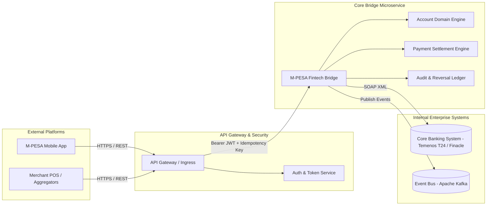

# Engineering Guide: Financial Microservices Architecture

## 1. Architectural Overview & Bounded Contexts
In modern financial institutions (e.g., Safaricom M-PESA, EthSwitch, Commercial Banks), monolithic architectures introduce severe risks: a bug in monthly fee deduction could take down real-time merchant checkouts. 

By decomposing the system into **Domain-Driven Design (DDD) Bounded Contexts**, services operate autonomously with isolated database schemas, distinct scaling properties, and clear network boundaries.



---

## 2. Core Microservice Principles Implemented in this Project

### A. Independent Service Responsibilities
1. **Authentication & Identity Service**:
   - Class: [AuthController.java](file:///d:/projects/safariintegration/src/main/java/com/safaricom/mpesa/controller/AuthController.java) & [JwtService.java](file:///d:/projects/safariintegration/src/main/java/com/safaricom/mpesa/service/JwtService.java)
   - Responsibility: Validates partner credentials, signs stateless JWT tokens, verifies permissions without hitting the primary customer ledger.
2. **Account Management Microservice**:
   - Class: [AccountController.java](file:///d:/projects/safariintegration/src/main/java/com/safaricom/mpesa/controller/AccountController.java) & [AccountServiceImpl.java](file:///d:/projects/safariintegration/src/main/java/com/safaricom/mpesa/service/AccountServiceImpl.java)
   - Responsibility: Manages customer wallet lifecycle, balance lookups, and credit/debit adjustments with optimistic locking.
3. **Transaction Settlement Microservice**:
   - Class: [PaymentController.java](file:///d:/projects/safariintegration/src/main/java/com/safaricom/mpesa/controller/PaymentController.java) & [PaymentServiceImpl.java](file:///d:/projects/safariintegration/src/main/java/com/safaricom/mpesa/service/PaymentServiceImpl.java)
   - Responsibility: Orchestrates high-speed C2B money movements, enforces duplicate prevention, and drives downstream integration.
4. **Audit Trail & Reversal Service**:
   - Class: [TransactionController.java](file:///d:/projects/safariintegration/src/main/java/com/safaricom/mpesa/controller/TransactionController.java) & [TransactionServiceImpl.java](file:///d:/projects/safariintegration/src/main/java/com/safaricom/mpesa/service/TransactionServiceImpl.java)
   - Responsibility: Immutable historical ledger and compensating financial reversals.

---

## 3. Step-by-Step Implementation in this Project

### Step 1: Externalizing Microservice Configuration
Microservices must be cloud-native and follow **The Twelve-Factor App** rules: configuration is stored in the environment, not hardcoded.

In [src/main/resources/application.yml](file:///d:/projects/safariintegration/src/main/resources/application.yml):
```yaml
server:
  port: ${PORT:8080}

spring:
  application:
    name: mpesa-fintech-bridge
  datasource:
    url: ${SPRING_DATASOURCE_URL:jdbc:mysql://localhost:3306/mpesa_db?createDatabaseIfNotExist=true&useSSL=false&allowPublicKeyRetrieval=true&serverTimezone=UTC}
    username: ${SPRING_DATASOURCE_USERNAME:root}
    password: ${SPRING_DATASOURCE_PASSWORD:""}
    driver-class-name: com.mysql.cj.jdbc.Driver

jwt:
  secret: ${JWT_SECRET:404E635266556A586E3272357538782F413F4428472B4B6250645367566B5970}
  expirationMs: ${JWT_EXPIRATION_MS:86400000}

fintech:
  soap:
    core-banking-endpoint: ${FINTECH_SOAP_CORE_BANKING_ENDPOINT:http://localhost:8080/ws/corebanking}
```

### Step 2: Stateless Communication Across Service Nodes
Because microservices scale horizontally behind Kubernetes ingress, server nodes must never store session state in local memory.
In [SecurityConfig.java](file:///d:/projects/safariintegration/src/main/java/com/safaricom/mpesa/config/SecurityConfig.java#L26):
```java
http
    .csrf(AbstractHttpConfigurer::disable)
    .sessionManagement(session -> session.sessionCreationPolicy(SessionCreationPolicy.STATELESS))
```

### Step 3: Resilient Service Discovery & Health Probes
Microservices running in container orchestrators require health telemetry:
- **Liveness Probe**: Confirms the JVM process is responsive.
- **Readiness Probe**: Confirms the database connection pool is healthy before accepting incoming transactions.

Configured in [k8s/deployment.yaml](file:///d:/projects/safariintegration/k8s/deployment.yaml#L36-L48):
```yaml
livenessProbe:
  httpGet:
    path: /actuator/health/liveness
    port: 8080
  initialDelaySeconds: 30
  periodSeconds: 10
readinessProbe:
  httpGet:
    path: /actuator/health/readiness
    port: 8080
  initialDelaySeconds: 20
  periodSeconds: 5
```

---

## 4. Real-World Production Scenario
During monthly salary disbursement days, the payment processing engine experiences a **10x surge in transaction requests**.
Because the microservice is isolated and decoupled:
1. The **Horizontal Pod Autoscaler (HPA)** detects CPU load > 70% and spins up additional pods (from 3 to 15 pods).
2. The **Account Domain Engine** handles read-heavy balance lookups without blocking payment submission threads.
3. If the legacy Core Banking SOAP service slows down, circuit breakers trip, preventing the entire gateway from thread pool exhaustion.
