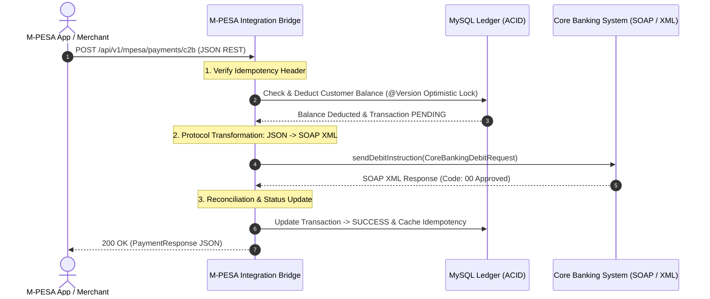

# Engineering Guide: Financial Middleware & Integration Patterns

## 1. Role of Middleware in Financial Systems
Middleware is the software glue and protocol adapter that connects modern, high-speed customer-facing channels (mobile apps, web portals, fintech wallets) to legacy, batch-oriented, or strictly formatted enterprise backends (Core Banking Systems, National Switches, SWIFT networks).



---

## 2. Core Middleware Patterns Implemented in this Project

### A. The Adapter & Protocol Translation Pattern
- **Problem**: Modern mobile apps speak JSON/REST over HTTP/2, whereas legacy core banking systems (Temenos T24, Finacle) communicate via SOAP XML or ISO 8583.
- **Solution**: The middleware acts as a protocol adapter. It translates incoming JSON fields into strongly typed XML SOAP envelopes and converts raw bank error codes (e.g., `51` Insufficient Funds, `96` System Malfunction) into clean, actionable domain messages.

### B. Two-Phase Financial Orchestration Loop
In [PaymentServiceImpl.java](file:///d:/projects/safariintegration/src/main/java/com/safaricom/mpesa/service/PaymentServiceImpl.java#L51-L135), the middleware implements the 6-step financial transaction pipeline:

```java
// Phase 1: Check Idempotency Cache (prevent double debiting)
Optional<IdempotencyRecord> existing = idempotencyRecordRepository.findById(idempotencyKey);
if (existing.isPresent()) {
    return objectMapper.readValue(existing.get().getResponsePayload(), PaymentResponse.class);
}

// Phase 2: Validate Account & Balance
Account sender = accountRepository.findByAccountNumber(request.getSenderMsisdn())
        .orElseThrow(() -> new IllegalArgumentException("Sender account not found"));
if (sender.getBalance().compareTo(request.getAmount()) < 0) {
    throw new InsufficientFundsException("Insufficient balance in account: " + sender.getAccountNumber());
}

// Phase 3: Create Audit Ledger Entry with PENDING status
String txRef = "MPESA" + System.currentTimeMillis() + UUID.randomUUID().toString().substring(0, 4);
Transaction transaction = new Transaction();
transaction.setTransactionReference(txRef);
transaction.setStatus(Transaction.TransactionStatus.PENDING);
transactionRepository.save(transaction);

// Phase 4: Atomic Debit with Optimistic Locking
sender.setBalance(sender.getBalance().subtract(request.getAmount()));
accountRepository.save(sender);

// Phase 5: Outbound SOAP RPC Call to Core Banking
CoreBankingDebitRequest soapReq = new CoreBankingDebitRequest(
        request.getReceiverBankAccount(), request.getAmount(), request.getCurrency(), txRef);
CoreBankingDebitResponse soapRes = soapClient.sendDebitInstruction(soapReq);

// Phase 6: Reconciliation & Automatic Reversal on Downstream Failure
if (soapRes.isSuccessful()) {
    transaction.setStatus(Transaction.TransactionStatus.SUCCESS);
    transactionRepository.save(transaction);
} else {
    // Automatic compensating reversal: restore balance
    sender.setBalance(sender.getBalance().add(request.getAmount()));
    accountRepository.save(sender);
    transaction.setStatus(Transaction.TransactionStatus.FAILED);
    transactionRepository.save(transaction);
}
```

---

## 3. Concurrency Protection: Optimistic Locking (`@Version`)
Financial middleware must support high concurrency without deadlocking database tables.

In [Account.java](file:///d:/projects/safariintegration/src/main/java/com/safaricom/mpesa/model/Account.java#L26-L28):
```java
@Version
private Long version;
```
### How Hibernate Optimistic Locking Works in Practice:
1. Thread A and Thread B both read customer account `251712345678` with balance `5,000 ETB` and `version = 0`.
2. Thread A debits `500 ETB` and commits first:
   ```sql
   UPDATE accounts SET balance = 4500.00, version = 1 
   WHERE id = 1 AND version = 0;
   ```
   *Row count is 1. Commit succeeds.*
3. Thread B attempts to debit `1,000 ETB`:
   ```sql
   UPDATE accounts SET balance = 4000.00, version = 1 
   WHERE id = 1 AND version = 0;
   ```
   *Row count is 0 because the version in the database is now 1!*
4. Hibernate throws `OptimisticLockingFailureException`. The middleware catches this, reloads fresh state, and re-evaluates the balance safely, preventing balance corruption without locking the database table.

---

## 4. Compensating Transactions & Administrative Reversals
When a customer disputes a transaction or transfers funds to the wrong merchant, financial regulations require a compensating reversal.

In [TransactionServiceImpl.java](file:///d:/projects/safariintegration/src/main/java/com/safaricom/mpesa/service/TransactionServiceImpl.java#L59-L84):
```java
@Transactional(isolation = Isolation.READ_COMMITTED, rollbackFor = Exception.class)
public TransactionResponse reverseTransaction(String reference, String reason) {
    Transaction tx = transactionRepository.findByTransactionReference(reference)
            .orElseThrow(() -> new ResourceNotFoundException("Transaction not found"));

    if (tx.getStatus() != TransactionStatus.SUCCESS) {
        throw new IllegalArgumentException("Cannot reverse transaction with status: " + tx.getStatus());
    }

    // Compensate sender account: restore debited amount
    Account sender = accountRepository.findByAccountNumber(tx.getSenderAccount())
            .orElseThrow(() -> new ResourceNotFoundException("Sender account not found"));

    sender.setBalance(sender.getBalance().add(tx.getAmount()));
    accountRepository.save(sender);

    tx.setStatus(TransactionStatus.REVERSED);
    tx.setFailureReason("Reversal executed: " + reason);
    return mapToResponse(transactionRepository.save(tx));
}
```
