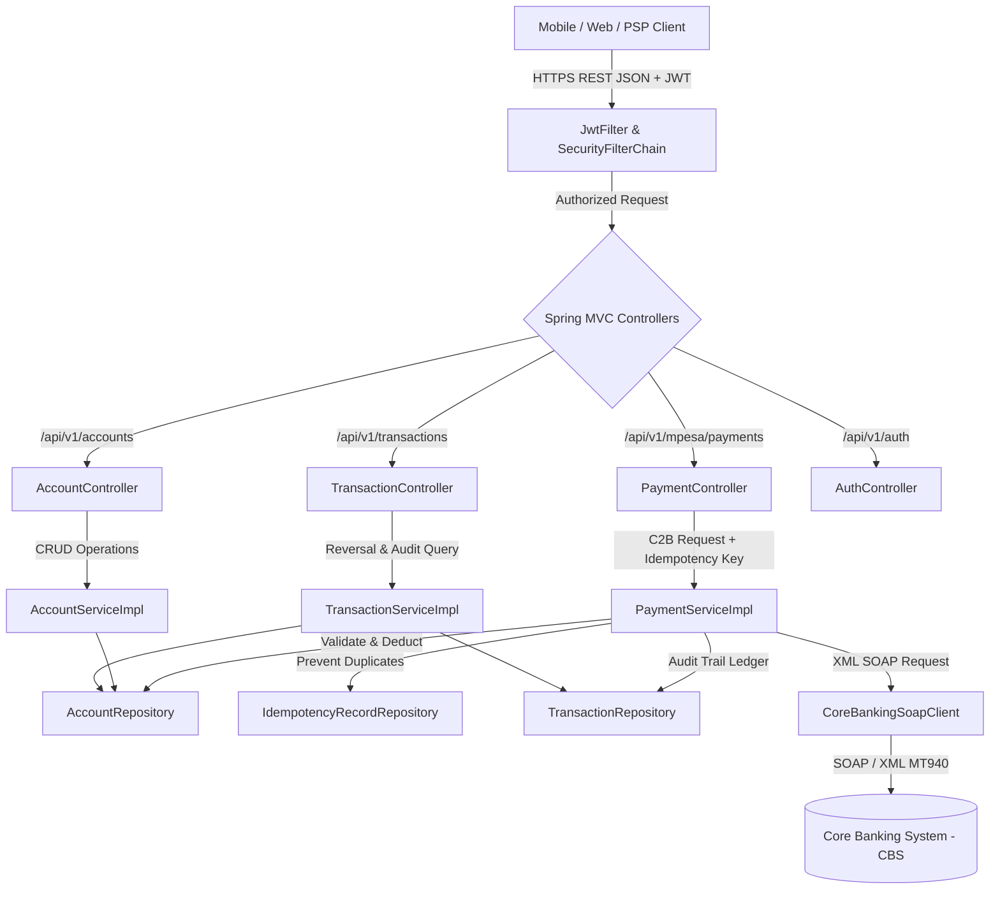

# Safaricom M-PESA & Core Banking Bridge: Package Architecture & Flow Guide

## System Architectural Overview

The **M-PESA Fintech Bridge** is an enterprise-grade financial integration middleware that securely connects external payment channels (telecom mobile money, PSPs, POS, merchant aggregators) to internal core banking ledgers (e.g., Temenos T24, Oracle FLEXCUBE, Finacle).



---

## 1. Package: `com.safaricom.mpesa.config`

### `SecurityConfig.java`
- **Location**: [SecurityConfig.java](file:///d:/projects/safariintegration/src/main/java/com/safaricom/mpesa/config/SecurityConfig.java)
- **Role**: Establishes zero-trust Spring Security perimeter, turns off stateful cookies/sessions, disables CSRF for REST statelessness, and injects `JwtFilter`.
- **Key Methods**:
  - `securityFilterChain(HttpSecurity http)`: Configures path whitelisting (`/api/v1/auth/**`, `/error`, `/actuator/**`) and forces all other requests to authenticate.
- **Flow**: Incoming requests hit this filter chain first. If no matching JWT or whitelisted pattern exists, execution is rejected immediately with HTTP 403 Forbidden.

### `JwtFilter.java`
- **Location**: [JwtFilter.java](file:///d:/projects/safariintegration/src/main/java/com/safaricom/mpesa/config/JwtFilter.java)
- **Role**: Extends `OncePerRequestFilter` to intercept HTTP requests, extract Bearer tokens from the `Authorization` header, and validate signatures.
- **Key Methods**:
  - `doFilterInternal(HttpServletRequest, HttpServletResponse, FilterChain)`: Reads header, extracts username, verifies expiration and HMAC-SHA secret, and sets `UsernamePasswordAuthenticationToken` in `SecurityContextHolder`.
- **Flow**:
  ```
  Request -> Header "Authorization: Bearer <jwt>" -> JwtFilter -> JwtService.validateToken() -> SecurityContextHolder populated -> Controller
  ```

---

## 2. Package: `com.safaricom.mpesa.controller`

### `AccountController.java` (Full CRUD REST API)
- **Location**: [AccountController.java](file:///d:/projects/safariintegration/src/main/java/com/safaricom/mpesa/controller/AccountController.java)
- **Role**: Full CRUD REST interface managing customer wallets and settlement accounts.
- **Endpoints & Methods**:
  - `POST /api/v1/accounts`: `createAccount(@Valid @RequestBody AccountCreateRequest)` -> HTTP 201 Created.
  - `GET /api/v1/accounts`: `getAllAccounts()` -> HTTP 200 OK with list of all registered accounts.
  - `GET /api/v1/accounts/{id}`: `getAccountById(@PathVariable Long id)` -> HTTP 200 OK.
  - `GET /api/v1/accounts/search?accountNumber=...`: `getAccountByNumber(@RequestParam String accountNumber)` -> HTTP 200 OK.
  - `PUT /api/v1/accounts/{id}`: `updateAccount(@PathVariable Long id, @Valid @RequestBody AccountUpdateRequest)` -> HTTP 200 OK.
  - `PATCH /api/v1/accounts/{id}/balance`: `adjustBalance(@PathVariable Long id, @Valid @RequestBody BalanceAdjustmentRequest)` -> HTTP 200 OK (Thread-safe credit/debit).
  - `DELETE /api/v1/accounts/{id}`: `deleteAccount(@PathVariable Long id)` -> HTTP 204 No Content.

### `PaymentController.java`
- **Location**: [PaymentController.java](file:///d:/projects/safariintegration/src/main/java/com/safaricom/mpesa/controller/PaymentController.java)
- **Role**: Ingestion endpoint for customer-to-business (C2B) financial flows.
- **Key Methods**:
  - `initiateC2BPayment(@RequestHeader("X-Idempotency-Key") String idempotencyKey, @Valid @RequestBody C2BPaymentRequest request)`: Enforces RFC 9110 client idempotency keys before invoking payment orchestration.

### `TransactionController.java`
- **Location**: [TransactionController.java](file:///d:/projects/safariintegration/src/main/java/com/safaricom/mpesa/controller/TransactionController.java)
- **Role**: Financial audit trail inspection and automated reversal management.
- **Key Methods**:
  - `getAllTransactions()`: Returns complete ledger of all transactions.
  - `getTransactionByReference(@PathVariable String reference)`: Fetches real-time status of a transaction (PENDING, SUCCESS, FAILED, REVERSED).
  - `reverseTransaction(@PathVariable String reference, @RequestBody Map<String, String> payload)`: Executes compensating reversal and credits funds back to sender account.

### `AuthController.java`
- **Location**: [AuthController.java](file:///d:/projects/safariintegration/src/main/java/com/safaricom/mpesa/controller/AuthController.java)
- **Role**: Public authentication service issuing signed JWT tokens.
- **Key Methods**:
  - `login(@Valid @RequestBody AuthRequest request)`: Verifies partner credentials against financial partner registry and outputs signed Bearer JWT token with TTL.

---

## 3. Package: `com.safaricom.mpesa.service`

### `PaymentService.java` & `PaymentServiceImpl.java`
- **Location**: [PaymentServiceImpl.java](file:///d:/projects/safariintegration/src/main/java/com/safaricom/mpesa/service/PaymentServiceImpl.java)
- **Role**: Mission-critical transaction engine executing the 6-phase financial processing loop:
  1. **Idempotency Verification**: Queries `IdempotencyRecordRepository`. If duplicate key detected, immediately serves cached JSON response without charging customer twice.
  2. **Account Validation**: Queries `AccountRepository` to verify sender balance >= requested amount.
  3. **Audit Ledger Logging**: Persists `Transaction` with status `PENDING`.
  4. **Account Balance Debit**: Subtracts amount with Hibernate `@Version` optimistic concurrency validation.
  5. **Core Banking Dispatch**: Sends outbound XML/SOAP debit instruction to core banking via `CoreBankingSoapClient`.
  6. **Reconciliation & Idempotency Storage**: On SOAP approval, sets status `SUCCESS` and caches response payload. On failure, automatically rolls back balance and records `FAILED`.

### `AccountService.java` & `AccountServiceImpl.java`
- **Location**: [AccountServiceImpl.java](file:///d:/projects/safariintegration/src/main/java/com/safaricom/mpesa/service/AccountServiceImpl.java)
- **Role**: Handles account lifecycle, duplicate account validation, safe updates, and balance adjustments with `@Transactional(isolation = Isolation.READ_COMMITTED)`.

### `TransactionService.java` & `TransactionServiceImpl.java`
- **Location**: [TransactionServiceImpl.java](file:///d:/projects/safariintegration/src/main/java/com/safaricom/mpesa/service/TransactionServiceImpl.java)
- **Role**: Manages immutable ledger lookups and handles compensating reversals by restoring debited balances and stamping audit records with `REVERSED`.

### `JwtService.java`
- **Location**: [JwtService.java](file:///d:/projects/safariintegration/src/main/java/com/safaricom/mpesa/service/JwtService.java)
- **Role**: Cryptographic component handling HMAC-SHA256 signing, claims decoding, expiration checks, and token generation.

### `service.soap.CoreBankingSoapClient.java`
- **Location**: [CoreBankingSoapClient.java](file:///d:/projects/safariintegration/src/main/java/com/safaricom/mpesa/service/soap/CoreBankingSoapClient.java)
- **Role**: SOAP WebService integration layer communicating with Temenos T24 / Finacle banking backends, parsing XML responses and ISO 8583 response codes (`00` Approved, `51` Insufficient Funds).

---

## 4. Package: `com.safaricom.mpesa.model`

### `Account.java`
- **Location**: [Account.java](file:///d:/projects/safariintegration/src/main/java/com/safaricom/mpesa/model/Account.java)
- **Fields**: `id`, `accountNumber` (unique), `accountHolderName`, `balance` (BigDecimal 19,4), `currency`, `version` (@Version).
- **Special Concurrency**: Uses `@Version` for JPA Optimistic Concurrency Control. If two concurrent threads attempt to debit the same account, the second transaction catches `OptimisticLockingFailureException` rather than corrupting balances.

### `Transaction.java`
- **Location**: [Transaction.java](file:///d:/projects/safariintegration/src/main/java/com/safaricom/mpesa/model/Transaction.java)
- **Fields**: `id`, `transactionReference` (unique), `senderAccount`, `receiverAccount`, `amount`, `currency`, `status` (PENDING, SUCCESS, FAILED, REVERSED), `failureReason`, `createdAt`.
- **Special Lifecycle Hook**: `@PrePersist protected void onCreate()` ensures timestamp is set immutably by the database tier upon creation.

### `IdempotencyRecord.java`
- **Location**: [IdempotencyRecord.java](file:///d:/projects/safariintegration/src/main/java/com/safaricom/mpesa/model/IdempotencyRecord.java)
- **Fields**: `idempotencyKey` (Primary Key), `transactionReference`, `responsePayload` (@Lob TEXT), `createdAt`.
- **Role**: Enforces RFC 9110 exactly-once delivery guarantees.

---

## 5. Package: `com.safaricom.mpesa.repository`

- `AccountRepository.java`: Extends `JpaRepository<Account, Long>`. Contains `findByAccountNumber(String)` and `existsByAccountNumber(String)`.
- `TransactionRepository.java`: Extends `JpaRepository<Transaction, Long>`. Contains `findByTransactionReference(String)`.
- `IdempotencyRecordRepository.java`: Extends `JpaRepository<IdempotencyRecord, String>`. Provides O(1) primary key lookup for idempotency keys.

---

## 6. Package: `com.safaricom.mpesa.dto`

- **Account Management**: `AccountCreateRequest`, `AccountUpdateRequest`, `BalanceAdjustmentRequest`, `AccountResponse`.
- **Payment Processing**: `C2BPaymentRequest`, `PaymentResponse`.
- **Authentication**: `AuthRequest`, `AuthResponse`.
- **SOAP Core Banking**: `CoreBankingDebitRequest`, `CoreBankingDebitResponse`.

---

## 7. Package: `com.safaricom.mpesa.exception`

- **`GlobalExceptionHandler.java`**: Implements RFC 7807 (`ProblemDetail`) for centralized financial error handling.
- **`InsufficientFundsException.java`**: Thrown when customer balance < debit amount.
- **`ResourceNotFoundException.java`**: Thrown when requested Account ID or Transaction Reference is missing in DB (HTTP 404).
- **`DuplicateTransactionException.java`**: Thrown when conflicting duplicate requests are detected.
