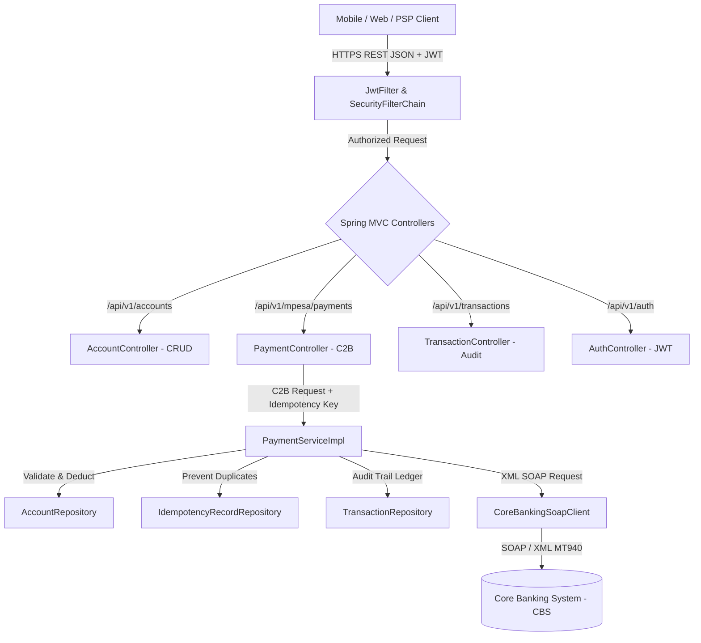

# paymentGatway: Safaricom M-PESA & Core Banking Integration Gateway

An enterprise-grade, high-throughput financial integration gateway and middleware built with **Spring Boot 3**, **Java 21 LTS**, and **Spring Security**. Connects external telecom payment channels (M-PESA mobile money, merchant aggregators, POS) to backend Core Banking Systems (CBS) such as Temenos T24 and Finacle with strict ACID guarantees, RFC 9110 idempotency, and DevOps CI/CD automation.

---

## Architecture Overview



---

## Key Features

- **Full CRUD REST API**: Comprehensive account management (create, query, search by MSISDN, update, thread-safe balance adjust, delete).
- **Payment Settlement Engine**: End-to-end customer-to-business (C2B) payments with two-phase financial orchestration.
- **RFC 9110 Idempotency**: Deduplicates concurrent or retransmitted payment requests via `X-Idempotency-Key` header without double-charging.
- **Optimistic Concurrency Control**: Uses JPA `@Version` on financial accounts to prevent lost-update race conditions without pessimistic table locks.
- **Zero-Trust Security**: HMAC-SHA signed JWT Bearer authentication filter on all protected endpoints.
- **Core Banking SOAP Middleware**: Outbound SOAP XML client simulating CBS debit dispatch and parsing ISO 8583 response codes.
- **DevOps & Cloud-Native Ready**: Docker multi-stage non-root container, Kubernetes manifests (Deployment, Service, ConfigMap, HPA), Jenkins declarative pipeline, and JMeter load testing plan (1000 TPS).

---

## Detailed Documentation Guides

This repository includes comprehensive, in-depth architectural and implementation guides:

| Document | Description |
| :--- | :--- |
| **[`API_DOCUMENTATION.md`](API_DOCUMENTATION.md)** | Full API specification with request/response schemas, validation rules, and cURL snippets |
| **[`PACKAGES_ARCHITECTURE.md`](PACKAGES_ARCHITECTURE.md)** | Breakdown of all packages, class functions, data flow, and interactions |
| **[`GUIDE_MICROSERVICES.md`](GUIDE_MICROSERVICES.md)** | Microservice decomposition, bounded contexts, and cloud-native patterns |
| **[`GUIDE_APIS.md`](GUIDE_APIS.md)** | Designing and securing financial APIs with Zero-Trust and validation |
| **[`GUIDE_MIDDLEWARE_INTEGRATION.md`](GUIDE_MIDDLEWARE_INTEGRATION.md)**| Protocol transformation (JSON to SOAP XML), idempotency, and reversals |
| **[`GUIDE_DEVOPS_INFRASTRUCTURE.md`](GUIDE_DEVOPS_INFRASTRUCTURE.md)**| Git, Docker multi-stage builds, Kubernetes orchestration, and Jenkins CI/CD |
| **[`GUIDE_CODE_QUALITY_TESTING.md`](GUIDE_CODE_QUALITY_TESTING.md)** | SonarQube quality gates, JUnit 5/Mockito tests, and Apache JMeter load tests |
| **[`GUIDE_AGILE_CROSS_FUNCTIONAL.md`](GUIDE_AGILE_CROSS_FUNCTIONAL.md)**| Agile Scrum/Kanban ceremonies, CBS stakeholder coordination, and 99.99% SLAs |
| **[`note.md`](note.md)** | In-depth notes on Java 21, Spring Boot, Databases, Kafka, and Cloud Platforms |

---

## Quickstart

### 1. Prerequisites
- **Java**: OpenJDK 21 LTS
- **Maven**: 3.9+
- **MySQL**: 8.0+ running on `localhost:3306` (or Docker)

### 2. Configure Database
Ensure MySQL is running and accessible (default database: `mpesa_db`, user: `root`, password: `""` or configured via `src/main/resources/application.yml`).

### 3. Build & Run
```bash
# Clone the repository
git clone https://github.com/biluyb/paymentGatway.git
cd paymentGatway

# Compile and start
mvn clean spring-boot:run
```

The application will start on port `8080`.

---

## Testing with cURL / Postman

### Step 1: Obtain JWT Bearer Token
```bash
curl -X POST http://localhost:8080/api/v1/auth/login \
  -H "Content-Type: application/json" \
  -d '{"username":"safari_partner","password":"partner@123"}'
```

### Step 2: Make a C2B Payment
```bash
curl -X POST http://localhost:8080/api/v1/mpesa/payments/c2b \
  -H "Authorization: Bearer <TOKEN_FROM_STEP_1>" \
  -H "X-Idempotency-Key: c2b-unique-uuid-001" \
  -H "Content-Type: application/json" \
  -d '{
    "senderMsisdn": "251712345678",
    "receiverBankAccount": "1000123456789",
    "amount": 500.00,
    "currency": "ETB"
  }'
```

---

## Docker & Container Deployment

```bash
# Build multi-stage Docker image
docker build -t payment-gateway:1.0.0 .

# Run with Docker Compose (MySQL + App)
docker compose up -d
```

---

## Author
**Bililign Yibgeta** — Senior Fintech Integration & Middleware Engineer
